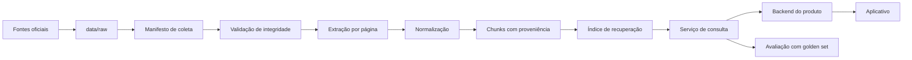
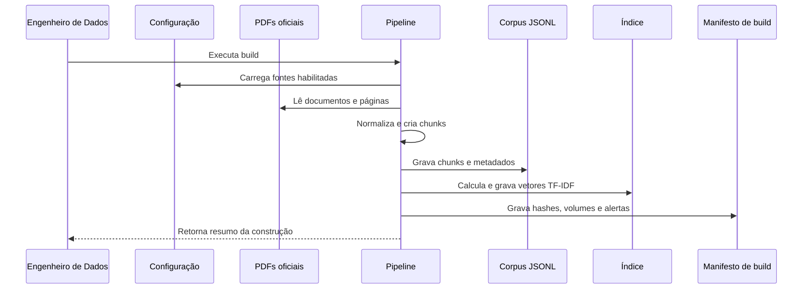
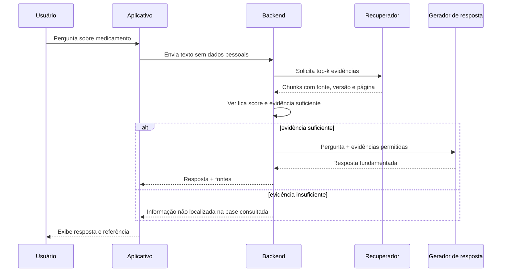
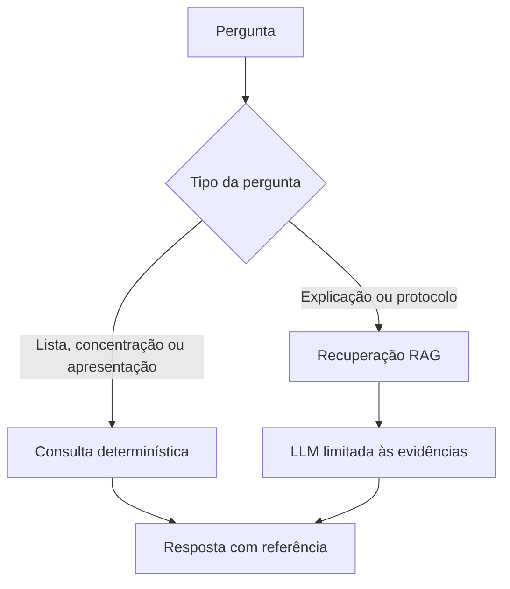

# SDD — Arquitetura de Engenharia de Dados do SUS Cidadão

**Status:** versão inicial implementável  
**Versão:** 1.0  
**Data:** 2026-11-03  
**Escopo:** MVP acadêmico para consulta de medicamentos e preparação da base RAG

## 1. Objetivo

Este documento descreve como a frente de Engenharia de Dados coleta, valida, transforma, indexa e publica informações oficiais usadas pelo SUS Cidadão.

A arquitetura deve permitir que o sistema responda perguntas como:

- “Este medicamento está na lista oficial?”;
- “A metformina 500 mg aparece na RENAME?”;
- “A losartana 50 mg aparece na REME-DF?”;
- “Quais documentos e preparos são exigidos para este exame?”, quando houver fonte oficial validada para isso.

O MVP não informa estoque em tempo real nem garante que um produto esteja disponível em uma unidade específica. Essa capacidade dependeria de uma fonte oficial atualizada que ainda precisa ser identificada e validada.

## 2. Princípios da solução

1. **Fonte oficial antes da IA:** toda resposta deve ser sustentada por documento identificado.
2. **Rastreabilidade:** cada trecho deve preservar documento, versão, data e página.
3. **Reprodutibilidade:** qualquer integrante deve conseguir reconstruir o corpus e o índice.
4. **Simplicidade:** execução local em Python, sem infraestrutura distribuída no MVP.
5. **Separação de responsabilidades:** recuperação encontra evidências; a LLM redige a resposta.
6. **Privacidade por padrão:** o pipeline inicial não recebe nome, CPF, CNS ou histórico clínico.
7. **Resposta conservadora:** ausência de evidência deve gerar “não localizado na base consultada”, e não uma conclusão inventada.

## 3. Escopo do MVP

### 3.1 Implementado agora

- armazenamento dos PDFs oficiais e seus manifestos;
- configuração das fontes habilitadas;
- extração de texto por página;
- normalização básica do texto;
- divisão em chunks com sobreposição;
- metadados de proveniência em todos os chunks;
- índice local TF-IDF com unigramas e bigramas;
- busca ranqueada por similaridade;
- saída textual e JSON pela linha de comando;
- manifesto de construção com hashes, volumes e alertas;
- testes unitários do chunking, ranking e consultas sem correspondência.

### 3.2 Depende de validação da equipe

- critérios clínicos do golden set;
- quais protocolos de exames serão incluídos;
- revisão da Carta de Serviços do HUB-UnB;
- modelo de resposta apresentado ao usuário;
- limiar mínimo para aceitar ou rejeitar uma evidência;
- escolha do provedor de LLM e embeddings semânticos;
- política para fotografias de receita ou embalagem;
- contrato de integração com o backend principal.

### 3.3 Versões futuras

- OCR de imagens e PDFs sem camada textual;
- busca semântica com embeddings;
- identificação de nome comercial e princípio ativo;
- extração estruturada de posologia e apresentação;
- localização de farmácias e unidades públicas;
- dados de disponibilidade, somente se existir fonte oficial confiável;
- histórico individual e relatório da trajetória do usuário;
- atualização automática e monitoramento das fontes.

## 4. Visão geral da arquitetura



O pipeline é executado em lote quando uma fonte é adicionada ou atualizada. As consultas usam o índice já construído, sem reprocessar os PDFs a cada pergunta.

## 5. Componentes

### 5.1 Catálogo de fontes

Arquivo: `config/rag_sources.json`.

Responsabilidades:

- indicar quais documentos estão habilitados;
- registrar identificador da fonte e do documento;
- registrar título, versão, data e território;
- indicar o caminho do arquivo;
- classificar o tipo de conteúdo.

Uma fonte com versão desconhecida ou revisão pendente deve permanecer desabilitada.

### 5.2 Zona de dados brutos

Diretório: `data/raw/`.

Contém cópias dos documentos oficiais sem alteração. O nome do arquivo deve indicar o conteúdo e a versão ou data do documento.

No MVP, os arquivos são versionados no Git porque o volume atual é pequeno e isso simplifica a reprodução acadêmica. O uso de DVC será reconsiderado caso o volume cresça significativamente ou surjam arquivos com restrição de distribuição.

### 5.3 Manifesto de coleta

Diretório: `data/manifests/`.

Para cada documento, deve registrar:

- URL oficial de origem;
- data da coleta;
- versão ou data documental;
- tamanho em bytes;
- hash SHA-256;
- situação da validação;
- observações relevantes.

O manifesto permite verificar se o arquivo foi alterado desde a coleta.

### 5.4 Extração e transformação

Módulo: `src/sus_cidadao_data/rag/pipeline.py`.

Etapas:

1. carregar a configuração;
2. verificar a existência dos arquivos habilitados;
3. extrair o texto de cada página com `pypdf`;
4. remover caracteres inválidos e espaços repetidos;
5. dividir o texto em chunks de 220 palavras;
6. repetir 40 palavras entre chunks consecutivos;
7. gerar um `chunk_id` estável a partir do documento, página, posição e conteúdo;
8. registrar alertas de páginas sem texto ou falhas de extração.

A extração preserva o número de página do PDF. Cabeçalhos e rodapés ainda podem aparecer no texto e serão tratados posteriormente se prejudicarem as métricas.

### 5.5 Corpus normalizado

Artefato: `.artifacts/rag/corpus.jsonl`.

Cada linha representa um chunk:

```json
{
  "chunk_id": "aa3804240dbe7c80499f",
  "text": "losartana potássica 50 mg comprimido...",
  "source_id": "F01",
  "document_id": "rename-2024-2ed",
  "title": "RENAME 2024 - 2ª edição",
  "version": "2024-2ed",
  "document_date": "2025",
  "territory": "Brasil",
  "content_type": "medicamentos",
  "page": 47,
  "chunk_index_on_page": 0
}
```

O corpus é derivado e reconstruível, portanto não é versionado no Git.

### 5.6 Índice de recuperação

Artefato atual: `.artifacts/rag/tfidf-index.json`.

O MVP utiliza TF-IDF porque:

- não exige API paga;
- é simples de explicar e auditar;
- funciona bem para nomes de medicamentos, concentrações e apresentações;
- fornece uma linha de base mensurável para comparar embeddings futuros.

O índice usa palavras e pares consecutivos de palavras. A consulta recebe a mesma normalização e é comparada aos chunks por similaridade de cosseno.

Um banco vetorial ainda não é necessário. Se o golden set demonstrar que o TF-IDF não recupera adequadamente sinônimos, nomes comerciais ou perguntas em linguagem natural, o componente poderá ser substituído por embeddings com FAISS, Chroma ou PostgreSQL/pgvector. O corpus e os metadados permanecerão iguais.

### 5.7 Interface de consulta

Módulo: `src/sus_cidadao_data/rag/cli.py`.

Construção:

```bash
uv run python -m sus_cidadao_data.rag.cli build
```

Consulta:

```bash
uv run python -m sus_cidadao_data.rag.cli search "metformina 500 mg" --top-k 5
```

Saída JSON para integração:

```bash
uv run python -m sus_cidadao_data.rag.cli search "losartana 50 mg" --json
```

O backend do produto deverá consumir uma função ou endpoint que devolva os mesmos campos da saída JSON.

## 6. Fluxo de construção



## 7. Fluxo de consulta para o usuário



A LLM não deve receber o PDF completo nem responder usando apenas conhecimento próprio. Ela deve usar exclusivamente as evidências recuperadas para afirmações sobre listas, documentos e protocolos.

## 8. Consultas determinísticas e RAG

### 8.1 Preferência por consulta determinística

Quando os medicamentos forem transformados em registros estruturados, as perguntas abaixo devem usar comparação determinística:

- o medicamento está em determinada lista;
- qual é a concentração registrada;
- qual é a forma farmacêutica;
- em qual componente ou programa aparece.

Essas consultas devem retornar verdadeiro, falso ou não localizado, sempre com referência documental.

### 8.2 Uso adequado de RAG

RAG será usado para:

- explicar regras descritas em texto;
- resumir documentos exigidos;
- descrever preparo de exames;
- localizar trechos em protocolos extensos;
- responder perguntas formuladas de maneiras variadas.

A arquitetura futura poderá usar os dois caminhos:



## 9. Modelo de dados futuro para medicamentos

A extração estruturada deverá gerar registros com os seguintes campos:

| Campo | Descrição |
|---|---|
| `medication_id` | Identificador interno estável |
| `active_ingredient_raw` | Texto original do princípio ativo |
| `active_ingredient_normalized` | Nome normalizado |
| `concentration_raw` | Concentração como aparece na fonte |
| `concentration_value` | Valor numérico quando extraível |
| `concentration_unit` | Unidade normalizada |
| `pharmaceutical_form` | Forma farmacêutica |
| `program_or_component` | Programa ou componente de assistência |
| `territory` | Brasil, DF ou outra abrangência |
| `source_id` | Fonte oficial |
| `document_id` | Documento e versão |
| `page` | Página da evidência |
| `valid_from` | Início da validade, se informado |
| `valid_to` | Fim da validade, se informado |

No MVP, esses dados podem ser publicados em Parquet ou SQLite. PostgreSQL só será necessário quando houver API compartilhada, escrita concorrente ou volume que justifique um serviço de banco.

## 10. Normalização e correspondência de medicamentos

A correspondência deve ocorrer em camadas:

1. normalizar caixa, acentos e espaços;
2. padronizar unidades como `mg`, `mcg`, `mL` e `mg/mL`;
3. comparar princípio ativo, concentração e forma farmacêutica;
4. consultar um dicionário validado de nomes comerciais e princípios ativos;
5. aplicar busca aproximada apenas como sugestão;
6. exigir confirmação quando houver ambiguidade.

Uma foto de receita ou embalagem deverá passar por OCR em componente separado. O texto reconhecido nunca deve ser aceito silenciosamente quando houver baixa confiança.

## 11. Qualidade e métricas

### 11.1 Qualidade do pipeline

| Métrica | Cálculo | Critério inicial |
|---|---|---|
| Documentos processados | processados / habilitados | 100% |
| Páginas extraídas | páginas com texto / total | ≥ 98% |
| Chunks rastreáveis | chunks com fonte, versão e página / total | 100% |
| Integridade | arquivos com hash correspondente / total | 100% |
| Falhas de build | builds com erro / builds executados | 0% antes da publicação |

### 11.2 Qualidade da recuperação

O golden set deve conter perguntas reais ou realistas, documento esperado e páginas ou trechos relevantes.

Métricas recomendadas:

- `Hit Rate@K`: existe ao menos uma evidência correta entre os K primeiros;
- `Recall@K`: proporção das evidências esperadas recuperadas;
- `MRR`: posição média do primeiro resultado correto;
- precisão de fonte: documento retornado é o esperado;
- precisão de citação: página apresentada contém a informação;
- taxa de abstenção correta: sistema recusa quando não existe evidência.

Critério inicial sugerido para o MVP: `Hit Rate@5 ≥ 0,85` no golden set revisado.

### 11.3 Qualidade da resposta da LLM

BLEU e ROUGE podem ser registrados para comparação textual, mas não devem ser as métricas principais porque uma resposta correta pode usar palavras diferentes da referência.

Priorizar:

- correção factual;
- aderência às evidências;
- completude dos itens obrigatórios;
- ausência de informação não suportada;
- citação correta;
- clareza para o usuário;
- abstenção quando a base não sustenta a resposta.

A avaliação deve combinar regras automáticas e revisão humana da enfermeira ou profissional de saúde responsável.

## 12. Segurança e LGPD

O corpus atual contém documentos públicos e não precisa armazenar dados pessoais.

Regras do MVP:

- não persistir texto digitado pelo usuário;
- não solicitar CPF, CNS, endereço ou nome completo;
- não armazenar fotos de receitas ou embalagens;
- remover conteúdo de logs que possa identificar uma pessoa;
- usar segredos apenas em variáveis de ambiente;
- nunca enviar `.env`, chaves ou tokens ao Git;
- limitar o acesso a artefatos que futuramente contenham dados sensíveis.

Se o produto passar a guardar histórico ou imagens, será necessária uma nova avaliação de impacto à proteção de dados, com finalidade, consentimento ou base legal, retenção, exclusão, controle de acesso e criptografia definidos antes da implementação.

## 13. Versionamento, linhagem e auditoria

A linhagem mínima é:

```text
URL oficial
  -> arquivo bruto + SHA-256
  -> configuração da fonte
  -> página extraída
  -> chunk_id
  -> versão do índice
  -> resultado recuperado
  -> resposta apresentada
```

O `build-manifest.json` deve permitir identificar:

- quando o índice foi construído;
- quais arquivos e hashes foram utilizados;
- parâmetros de chunking;
- total de documentos, páginas e chunks;
- alertas de extração;
- hash do corpus resultante.

Para auditoria completa, a API futura deverá registrar `request_id`, versão do corpus, chunks utilizados, modelo de LLM e versão do prompt, sem registrar dados pessoais desnecessários.

## 14. Implantação do MVP

### 14.1 Ambiente local

```text
Python 3.12
uv
pypdf
pytest
ruff
mypy
```

### 14.2 Integração contínua recomendada

Em cada pull request:

1. instalar dependências com `uv sync --locked`;
2. verificar formatação com Ruff;
3. executar lint;
4. executar Mypy;
5. executar testes;
6. construir o corpus com uma amostra ou com os documentos completos;
7. executar o golden set quando ele estiver disponível.

Os índices derivados não devem ser enviados ao Git. Em uma implantação futura, eles podem ser gerados no CI e publicados como artefato versionado ou construídos durante o processo de deploy.

## 15. Estrutura do repositório

```text
sus-cidadao-engenharia-dados/
├── config/
│   └── rag_sources.json
├── data/
│   ├── raw/
│   ├── manifests/
│   └── README.md
├── docs/
│   ├── sdd-arquitetura-engenharia-dados.md
│   ├── especificacao-funcional-mvp.md
│   ├── levantamento-fontes.md
│   └── kanban-semana-rag.md
├── src/
│   └── sus_cidadao_data/
│       └── rag/
│           ├── cli.py
│           └── pipeline.py
├── tests/
│   └── test_rag_pipeline.py
├── .gitignore
├── pyproject.toml
├── uv.lock
└── README.md
```

## 16. Decisões arquiteturais

| Decisão | Estado | Justificativa |
|---|---|---|
| Python 3.12 e uv | Adotada | Stack simples e reproduzível |
| PDFs e manifestos no Git | Adotada no MVP | Volume atual pequeno e facilidade acadêmica |
| Índices fora do Git | Adotada | São derivados e reconstruíveis |
| TF-IDF como baseline | Adotada | Gratuito, auditável e adequado a termos exatos |
| Banco vetorial | Adiado | Depende do resultado do golden set |
| Banco relacional | Adiado | Ainda não há dataset estruturado nem API compartilhada |
| LLM na recuperação | Rejeitada | Recuperação deve ser testável independentemente da geração |
| Histórico pessoal | Futuro | Exige desenho de produto, segurança e LGPD |
| Estoque em tempo real | Fora do MVP | Nenhuma fonte oficial validada foi encontrada até agora |

## 17. Riscos e controles

| Risco | Impacto | Controle |
|---|---|---|
| PDF muda sem aviso | Resposta baseada em versão antiga | Hash, data e revisão periódica |
| Extração perde tabelas | Medicamento não é localizado | Métricas por página e revisão amostral |
| Nome comercial não aparece | Baixa recuperação | Dicionário validado e embeddings futuros |
| LLM inventa informação | Risco ao usuário | Prompt restrito, citações e abstenção |
| Pergunta genérica retorna trecho irrelevante | Resposta enganosa | Limiar de score e validação no golden set |
| Documento local desatualizado | Informação incorreta | Manifesto, versão visível e rotina de atualização |
| Foto contém dados sensíveis | Exposição de dado de saúde | Não persistir no MVP; política antes da funcionalidade |

## 18. Critérios de aceite da arquitetura

A arquitetura inicial será considerada operacional quando:

- uma instalação limpa executar `uv sync` sem ajustes manuais;
- o pipeline processar todas as fontes habilitadas;
- cada resultado contiver fonte, versão, página e `chunk_id`;
- o build produzir manifesto com hashes e alertas;
- os testes, Ruff e Mypy passarem;
- os artefatos puderem ser apagados e reconstruídos com o mesmo corpus;
- o golden set inicial estiver revisado por uma pessoa da área da saúde;
- o mecanismo recusar perguntas sem evidência suficiente;
- a integração com o backend preservar as citações.

## 19. Próximas entregas

1. criar golden set inicial de medicamentos;
2. adicionar avaliação `Hit Rate@K`, `Recall@K` e `MRR`;
3. definir e calibrar limiar de abstenção;
4. estruturar medicamentos em registros normalizados;
5. comparar TF-IDF com embeddings usando o mesmo golden set;
6. criar contrato de API para o backend do produto;
7. integrar a LLM somente depois da validação da recuperação;
8. ampliar o corpus para protocolos de exames validados.
