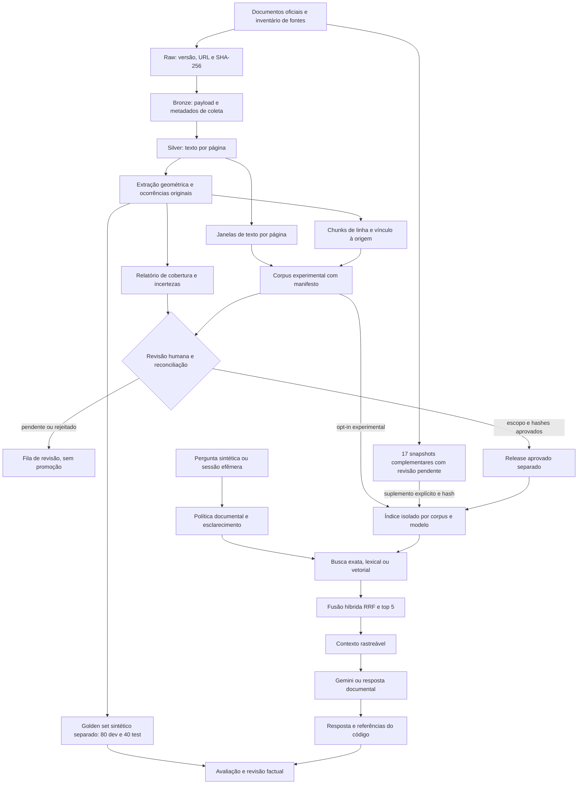

# Arquitetura do RAG ampliado

**Objetivo:** Descrever a arquitetura experimental do corpus e do RAG ampliado, seus contratos, limites e estado de integração.

Este documento descreve contratos, código inspecionado e lacunas; não registra
resultados de execução nem aprova automaticamente dados. Atualização documental: 07/11/2026; coleta inspecionada em 06/11/2026.

## 1. Escopo e fronteiras

O terminal consulta evidências documentais das versões congeladas da RENAME 2024
2ª edição, REME-DF de 29/10/2026 e Farmácia Popular de 31/08/2026. A expansão
busca a união das ocorrências das três listas, preservando diferenças de sal,
concentração, forma, liberação e associações. Não corresponde à interseção nem
à ampliação automática das seis apresentações anteriormente aprovadas.

O release aprovado e o corpus experimental têm ciclos distintos. O experimental
exige opção explícita e mantém pendências; aprovação anterior não é herdada por
novas ocorrências. Presença documental não comprova estoque, elegibilidade
individual ou conduta clínica. Documentos e eventuais snapshots representam o
momento registrado, sem promessa de atualização ou disponibilidade atual.

## 2. Fluxo documental e de consulta

O diagrama inclui o alvo de integração. Golden set e respostas de referência
nunca alimentam o índice. O gate de revisão é requisito de publicação; não é
uma aprovação executada por esse fluxo ou pelo gerador de corpus.

## 3. Extração, geometria e chunking

O pipeline preserva os PDFs por hash e produz texto Silver por página. A
construção schema 2 usa extração geométrica em `rag.table_extract`, mantendo
texto original e proveniência. O relatório gerado registra **2.115 ocorrências**:
996 RENAME (Apêndice A, páginas físicas 26–132), 1.078 REME (páginas 12–59,
itens 1–1078 sem lacunas) e 41 Farmácia Popular (39 medicamentos candidatos e
2 insumos). Preserva texto de **366 páginas** e produz **2.620 chunks**.
O catálogo contém **1.651 apresentações literais completas candidatas**, não
equivalentes terapêuticos únicos. Reconciliação integral e aprovação humana
permanecem pendentes.

Na RENAME, nomes compartilhados só podem ser herdados de células geometricamente
mescladas. Na REME, limites de células separam descrição, código e canal.
Farmácia Popular mantém leitura literal e não infere forma ausente.
O catálogo candidato consolida conservadoramente nome, concentração e forma,
sem presumir equivalência entre sais, liberações ou associações. Campos
desconhecidos ficam nulos e ocorrências originais permanecem auditáveis.

O manifesto registra chunks de até **2.000 caracteres Unicode**, com
**sobreposição máxima de 240 caracteres**, dentro da página ou linha de tabela.
Todos os 2.620 chunks da rodada respeitam o limite informado no relatório.
A unidade é caractere, não token. Linhas mantêm vínculos com ocorrências e
origem; a revisão deve verificar se as divisões preservam identidade e contexto.

O coletor complementar tem chunking independente: até 1.600 caracteres,
preferindo quebra de linha/espaço na segunda metade da janela, sem sobreposição.
PDFs usam página; HTML usa seção com offsets. Seu conteúdo só entra nas consultas
quando `--supplement data/raw/complementares/chunks.jsonl` é passado; o hash
desse arquivo integra o fingerprint do corpus carregado.

| Artefato em `data/corpus/experimental` | Finalidade |
|---|---|
| `occurrences.jsonl` | Ocorrências originais, campos, fonte e incertezas |
| `chunks.jsonl` | Texto recuperável e IDs vinculados à origem |
| `report.json` | Cobertura, contagens, lacunas e limitações |
| `manifest.json` | Versões, fontes, parâmetros disponíveis e hashes |

`catalog.jsonl` contém o catálogo candidato; os insumos permanecem classificados
separadamente nas ocorrências, sem contagem como medicamentos.
Cada chunk precisa de fonte, versão, hash, página/seção e origem. Alterações
de conteúdo/geometria podem mudar IDs: reconstruir índice e golden set juntos.

Preservar páginas ou extrair todos os números de item de uma tabela não comprova
extração completa das seções pertinentes. A conclusão exige reconciliação
visual, incluindo tabelas secundárias, páginas sem candidatos, células
mescladas, continuidades, duplicatas, exclusões e insumos. Extração automatizada
e inspeção amostral não equivalem à revisão integral.

## 4. Gate de curadoria

Para cada lote, o revisor confere documento e hash, página/linhas, texto original,
identidade e apresentação, pertinência à lista e natureza do item. Registra
responsável, data, IDs exatos, decisões, correções e pendências. Uma nova versão
não recebe aprovação por semelhança com o lote anterior. A publicação deve
validar os arquivos exatos cobertos pela revisão e manter o release anterior.

A meta é pelo menos **20 documentos-fonte distintos, pertinentes e curados**.
São pelo menos 17 adicionais às três listas. Páginas, chunks, cópias do mesmo
documento e índices de links não contam como novas fontes. Baixar um documento
ou registrá-lo no inventário não conclui sua curadoria.

## 5. Recuperação, geração e falhas

Contrato informado para a integração principal: comandos `index`, `search`,
`ask`, `chat`, `eval` e legado; opções `--experimental`, `--corpus`,
`--strategy hybrid|lexical|vector|exact`, `--documental` e `--show-context`.
Interface conferida em `rag.cli.main` e `rag.experimental_cli.run`; os comandos
reproduzíveis estão no [guia](../guia-entrega-semana2.md). A avaliação inclui
`--stage retrieval|generation|end-to-end` e `--frozen-dataset-sha256`.

O módulo `rag.experimental` inspecionado combina BM25Plus e busca vetorial por
Reciprocal Rank Fusion: cada ranking contribui com `1 / (60 + posição)`, com
pesos iguais e até 20 candidatos por ranking. A tokenização normaliza acentos,
caixa e espaços, extrai palavras e remove uma lista local de stopwords. Empates
usam ID; trechos normalizados idênticos da mesma fonte são deduplicados. Nomes
literais identificados restringem resultados aos chunks de linha candidatos,
com verificações de concentração/forma. A apresentação padrão é top 5.
Busca `exact` não autoriza completar campos desconhecidos nem misturar formas.

Chroma é persistente. No caminho legado inspecionado, a pasta deriva do
fingerprint do release e do modelo de embeddings; o marcador `index.json`
verifica identidade e número de evidências. O experimental precisa preservar
isolamento equivalente. O módulo experimental já deriva a pasta do fingerprint,
modelo e marcador `experimental-v1`; aceita lotes de 1–128; a CLI usa lotes de 8 e cadência de 90 textos/minuto,
retoma IDs ausentes e só publica marcador após conferir todos os IDs. O leitor
aceita suplemento explícito, cujo hash participa do fingerprint; a ligação
desse argumento à CLI usa `--supplement` explicitamente. Modelos são configuráveis; os padrões inspecionados
são `models/gemini-embedding-001` e `gemini-2.5-flash`, com temperatura de chat
zero. Isso não promete determinismo da geração ou disponibilidade do provedor.

O contexto deve ser tratado como dado não confiável, não como instruções.
Ambiguidade exige esclarecimento; ausência de sustentação exige abstenção.
Perguntas de dose, diagnóstico ou substituição não são respondidas como conduta
clínica. Falhas de chave, rede, quota ou índice devem aparecer como falhas,
sem inventar evidências ou resultados. O chat mantém apenas a pergunta ambígua em memória e agrega respostas curtas
compatíveis com concentração/forma; uma pergunta independente reinicia a consulta.
Erros por consulta exibem o tipo da falha. A sessão não grava histórico pessoal.

### Citação determinística não é fidelidade semântica

Referências montadas pelo código podem garantir que IDs, URLs e páginas vêm
do corpus. Não garantem que cada afirmação da resposta seja apoiada pelo trecho,
que a extração seja correta ou que o ranking tenha selecionado a apresentação
certa. A avaliação separa validade de referência, suporte factual de cada
afirmação, completude e ausência de extrapolação. BLEU e ROUGE não substituem
essa revisão. O gerador experimental também exige pelo menos uma citação e
rejeita IDs fora do contexto, substituindo a resposta quando a validação falha.
Essa checagem não verifica suporte de cada frase nem cobertura das afirmações.

## 6. Avaliação, privacidade e estado

O golden set contém 120 rascunhos sintéticos, com 80 dev e 40 test separados por
família. Geração por templates não constitui aprovação humana nem garante
cobertura de esclarecimento, abstenção e situações críticas. Revisar referências,
IDs e comportamento esperado; congelar teste antes dos ajustes finais.

Separar recuperação, geração com contexto de referência e fluxo completo.
Relatar Hit@1/3/5, Recall/Precision@5 e MRR@5, além de correção, fidelidade,
completude, citações, esclarecimento e abstenção. O módulo de métricas inspecionado
deduplica IDs; precisão usa denominador k mesmo com menos resultados. O cálculo atual expõe `mrr@5`, com `mrr` como alias limitado a cinco.
BLEU usa SacreBLEU (0–100, tokenização 13a); ROUGE-1/2/L expõe médias de
precisão, recall e F1 (0–1), tokenização Unicode NFC/casefold que preserva
acentos, sem stemming. Citações reconhecidas são removidas antes dos scores. Registrar versões e assinatura do BLEU.

Performance requer três repetições, concorrência um, p50/p95, erros, tokens,
tempo de indexação, vazão e indicação de aquecimento/cache. Replay de predições
não mede latência do serviço RAG. Métricas humanas e tempos não instrumentados
continuam pendentes, mesmo que o cálculo automático termine.

Perguntas pessoais não devem ser persistidas. Usar somente casos sintéticos
identificados em benchmarks, demonstrações gravadas e artefatos. O benchmark
inspecionado salva perguntas, respostas, referências e métricas **sintéticas**
para revisão, sem mensagens de exceção ou metadados arbitrários. Uso do provedor transmite o contexto necessário: não colocar dados
pessoais ou segredos nesses exemplos, logs ou pacote de entrega.

| Estado | Interpretação nesta documentação |
|---|---|
| Implementado por inspeção | Pipeline, corpus geométrico schema 2, coletor complementar, componentes legados, recuperação/geração experimental e métricas |
| Implementado por inspeção | CLI ampliada, suplemento explícito e avaliação por etapas com gate de teste congelado |
| Gerado, sem aprovação humana | Corpus schema 2, chunks 2000/240 e catálogo candidato |
| Em integração | Fluxo de curadoria e loader `--curated`; não presumir opção disponível antes de conferir `--help` |
| Verificado nesta tarefa documental | Ajuda CLI, lint/formatação do empacotador, fixtures de pacote e dry-run; sem execução de avaliação ou indexação |
| Pendente de evidência | Reconciliação completa, 20 fontes curadas, revisão/congelamento do golden set e resultados finais |
