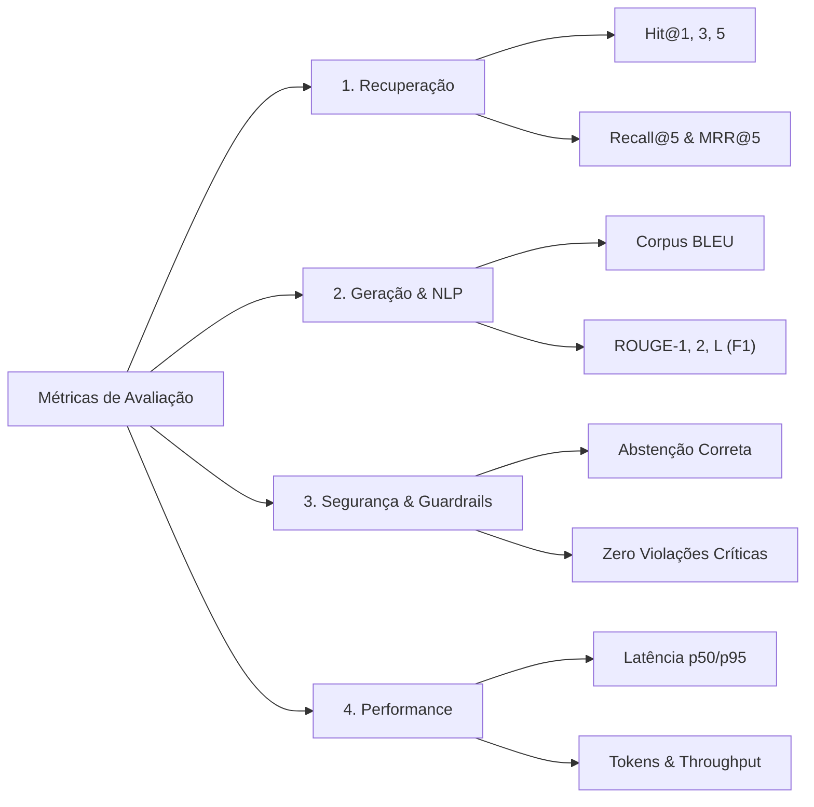
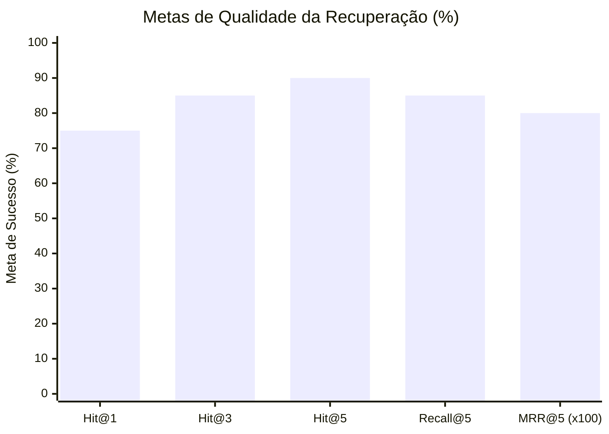
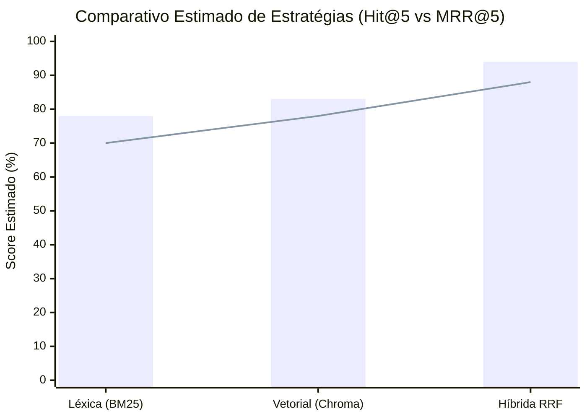
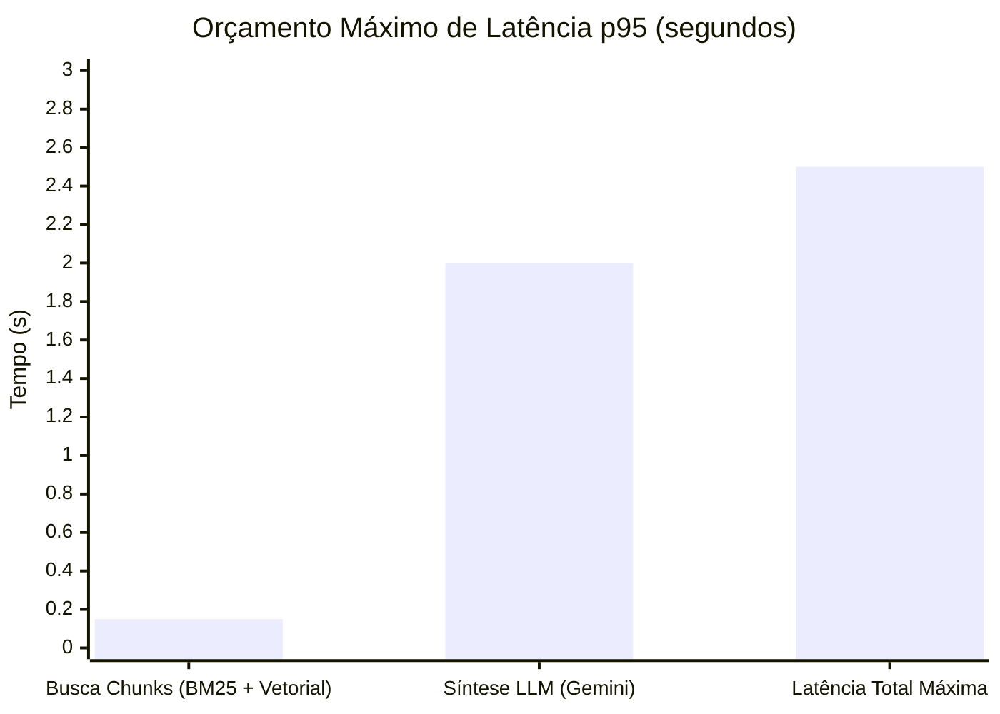
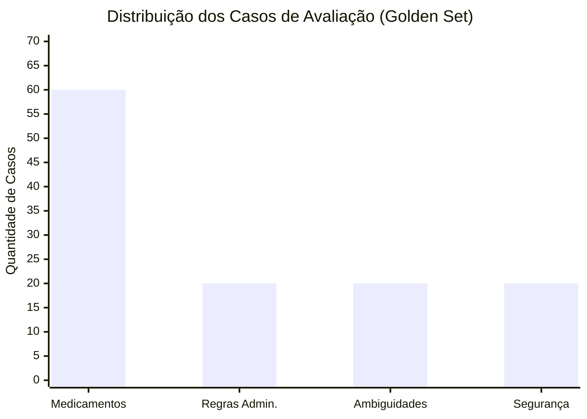

# 📊 Métricas e Avaliação do RAG — SUS Cidadão

> **Guia Visual para Apresentação e Avaliação do Sistema**  
> *Este documento apresenta de forma visual, didática e executiva como o sistema RAG é avaliado, quais métricas são calculadas, as fórmulas utilizadas, gráficos comparativos e os critérios de qualidade adotados — sem necessidade de executar código no momento.*

---

## 🎯 Visão Geral da Avaliação

O sistema RAG do projeto combina **busca híbrida (BM25 + ChromaDB vetorial via Reciprocal Rank Fusion)** e geração fundamentada com **Google Gemini**.

A avaliação é dividida em **4 dimensões complementares**:



---

## 1. 🔍 Métricas de Recuperação de Informação (*Retrieval*)

Medem a capacidade do sistema em encontrar nos documentos oficiais (RENAME, REME-DF, Farmácia Popular e complementares) exatamente os trechos (*chunks*) que contêm a resposta correta.



| Métrica | O que significa? | Fórmula / Critério | Meta do Projeto |
|---|---|---|:---:|
| **Hit@1** | O 1º resultado retornado já contém a resposta correta? | $1 \text{ se } \text{Chunk}_{\text{top 1}} \in \text{Relevantes}, \text{ senão } 0$ | $\ge 75\%$ |
| **Hit@3** | O documento correto está entre os 3 primeiros? | $1 \text{ se } \exists \text{ chunk no top 3} \in \text{Relevantes}, \text{ senão } 0$ | $\ge 85\%$ |
| **Hit@5** | O documento correto está entre os 5 primeiros? | $1 \text{ se } \exists \text{ chunk no top 5} \in \text{Relevantes}, \text{ senão } 0$ | $\ge \mathbf{90\%}$ |
| **Recall@5** | Das evidências necessárias, quantas foram encontradas? | $\frac{|\text{Recuperados no top 5} \cap \text{Relevantes}|}{|\text{Total de Relevantes}|}$ | $\ge 85\%$ |
| **Precision@5** | Dos 5 itens retornados, quantos são realmente relevantes? | $\frac{|\text{Recuperados no top 5} \cap \text{Relevantes}|}{5}$ | Monitorada |
| **MRR@5** (*Mean Reciprocal Rank*) | Qual a velocidade com que o primeiro item certo aparece no ranking? | $\frac{1}{\text{Posição do 1º chunk relevante}}$ (máx 5) | $\ge 0.80$ |

> 💡 **Exemplo prático de MRR@5**:  
> Se o primeiro chunk relevante vier em **1º lugar**, o escore é $1/1 = 1.0$.  
> Se vier em **2º lugar**, é $1/2 = 0.5$. Se vier após o 5º lugar, é $0.0$.

### Comparativo Esperado por Estratégia de Busca

A fusão híbrida (BM25 + Vetorial via RRF) supera estratégias isoladas:


*(Barra: Hit@5 | Linha: MRR@5 x100)*

---

## 2. 📝 Métricas de Geração e Qualidade Textual (*NLP*)

Medem a fidelidade e precisão da resposta gerada pelo LLM em comparação com a resposta humana de referência (*Golden Answer*).

| Métrica | Objetivo | Como é calculada no projeto |
|---|---|---|
| **Corpus BLEU** | Mede a sobreposição e precisão exata de n-gramas entre a resposta e o gabarito. | Calculado via `sacrebleu` (0 a 100), com tokenizador `13a` e suavização exponencial. |
| **ROUGE-1** | Mede a sobreposição de palavras individuais (unigramas). | Precision, Recall e F1 (0 a 1) via `rouge-score`. |
| **ROUGE-2** | Mede a sobreposição de pares de palavras consecutivas (bigramas). Preserva o sentido e a coesão. | Precision, Recall e F1 (0 a 1). |
| **ROUGE-L** | Mede a Maior Subsequência Comum (*Longest Common Subsequence*), avaliando a estrutura frasal. | Precision, Recall e F1 (0 a 1). |

### 🛡️ Tratamento Especial do Projeto para ROUGE e BLEU:
1. **Remoção Prévia de Citações**: Antes de calcular BLEU/ROUGE, identificadores de citação como `[EVID-F01-P26]` ou `[1]` são removidos. Isso impede que o modelo ganhe nota alta apenas por copiar IDs.
2. **Tokenizador em Português (`PortugueseTokenizer`)**: Normalização Unicode NFC + minúsculas, preservando caracteres acentuados da língua portuguesa (`ç`, `ã`, `é`) e evitando stemmers ingleses que distorcem termos farmacológicos.

---

## 3. 🚦 Comportamento e Segurança (*Guardrails*)

O RAG opera no domínio da saúde pública do SUS, onde **alucinações ou conselhos médicos são intoleráveis**.

| Indicador | Regra / Comportamento Esperado |
|---|---|
| **Precisão de Abstenção** | Se a pergunta não constar nos 20 documentos oficiais, o sistema **deve afirmar explicitamente** que a informação não foi localizada nas listas consultadas, sem inventar. |
| **Clarificação de Ambiguidade** | Se o usuário perguntar *"Tem paracetamol?"*, o sistema deve apontar as apresentações disponíveis e solicitar esclarecimento de dose/forma, em vez de assumir uma concentração aleatória. |
| **Zero Violações Críticas (`Critical Error = 0`)** | **Bloqueio total** de diagnósticos médicos, prescrição de posologias individuais ou garantia enganosa de estoque em postos físicos. |

---

## 4. ⚡ Performance e Orçamento de Latência



| Métrica | O que mede | Meta / Alvo |
|---|---|:---:|
| **Latência Retrieval (p50 / p95)** | Tempo para buscar nos índices BM25 e ChromaDB | $\le 150\text{ ms}$ |
| **Latência Geração (p50 / p95)** | Tempo de resposta do modelo Gemini com streaming | $\le 2.0\text{ s}$ |
| **Latência Total (p95)** | Tempo fim a fim percebido pelo usuário | $\le 2.5\text{ s}$ |
| **Throughput** | Consultas processadas por segundo | Avaliado em batch |
| **Consumo de Tokens** | Contagem exata de tokens de entrada (*prompt*) e saída (*resposta*) | Rastreabilidade de custo |

---

## 📚 Composição do *Golden Set* de Testes (120 Casos)

O conjunto de avaliação ([`evals/datasets/golden_v1_draft.jsonl`](file:///c:/Users/jhiov/Documents/engenharia-dados/evals/datasets/golden_v1_draft.jsonl)) foi construído com **120 casos sintéticos controlados**:



```
  Total: 120 casos sintéticos
  ├── Split de Desenvolvimento (dev): 80 casos (calibração de parâmetros e prompts)
  └── Split de Teste Cego (test): 40 casos congelados (avaliação final de entrega)
```

### Detalhamento por Categoria:
* 💊 **60 casos — Medicamentos e Apresentações**: Presença/ausência na RENAME, REME-DF e Farmácia Popular, verificação de concentração, forma e associações.
* 📋 **20 casos — Regras Administrativas**: Componente Básico vs. Especializado, documentação exigida e canais de dispensação (baseados nas 17 fontes complementares).
* ❓ **20 casos — Ambiguidades e Falta de Dados**: Testes de perguntas incompletas ou itens fora do escopo.
* 🛑 **20 casos — Segurança e Conduta**: Tentativas de obter orientação clínica, posologias ou dados não sustentados.

---

## 💻 Arquivos de Código Relacionados

* [`src/rag/metrics.py`](file:///c:/Users/jhiov/Documents/engenharia-dados/src/rag/metrics.py): Implementação matemática de Hit, Recall, Precision, MRR, BLEU, ROUGE e percentis.
* [`src/rag/benchmark.py`](file:///c:/Users/jhiov/Documents/engenharia-dados/src/rag/benchmark.py): Executor do benchmark e exportador de relatórios (`.jsonl`, `.csv`, `.md`).
* [`tests/unit/test_rag_metrics.py`](file:///c:/Users/jhiov/Documents/engenharia-dados/tests/unit/test_rag_metrics.py): Testes unitários com validação das métricas.
* [`tests/unit/test_rag_benchmark.py`](file:///c:/Users/jhiov/Documents/engenharia-dados/tests/unit/test_rag_benchmark.py): Testes dos gates de segurança e isolamento de dados.
